<div align="center">

# Constella

**Account-twin revenue intelligence for Creative Newtech Limited**

*Creative Newtech × E-Cell IIT Bombay Hackathon · Problem Statement 1: "Beyond Distribution: growing wallet share and solution selling across the customer network"*

**[Live prototype](https://constella-cnl.vercel.app)** · **[Live API docs](https://constella-cnl.onrender.com/docs)** · **[Solution document and pitch video](https://drive.google.com/drive/folders/1TuzWLrr9LLNL6KPNZAltIrK8jScpjtsk?usp=sharing)**

`FastAPI` · `scikit-learn` · `LangGraph` · `bge-small embeddings` · `React 19` · `three.js` · `MapLibre` · `Sentinel-2 / NASA GIBS` · `OpenStreetMap`

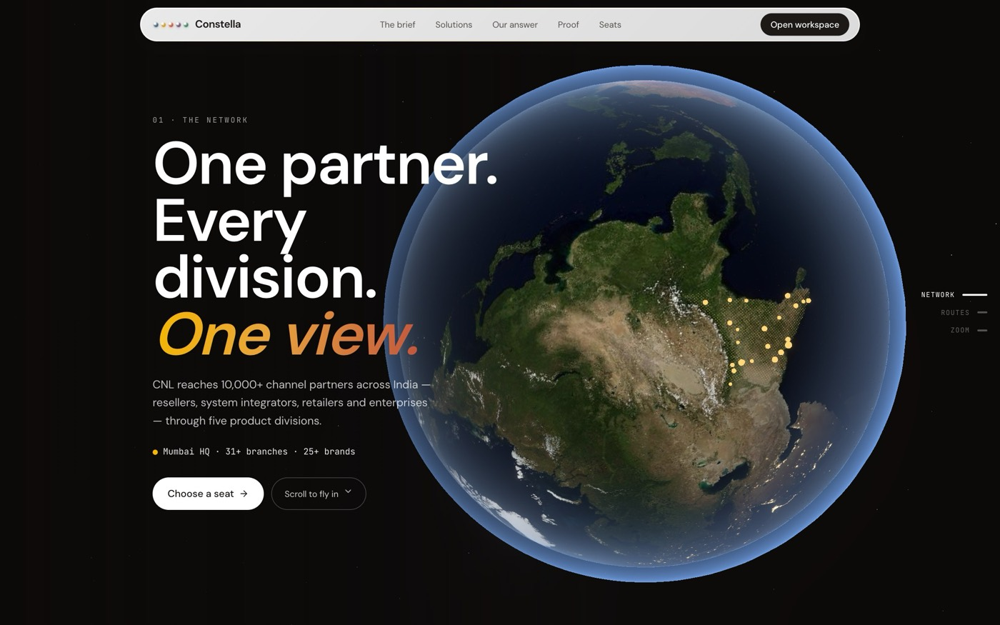

*Built by **Team Outliers**: Swayam Panchal · Jeevesh Bodhani · Rishit Lahoti · Shreyas Kale*

</div>

---

## Contents

1. [The problem](#1-the-problem)
2. [What Constella does](#2-what-constella-does)
3. [How it answers the five PS points](#3-how-it-answers-the-five-ps-points)
4. [Product tour (screenshots)](#4-product-tour)
5. [Personas: who uses it](#5-personas-who-uses-it)
6. [One opportunity, end to end](#6-one-opportunity-end-to-end)
7. [Feature map](#7-feature-map)
8. [Architecture](#8-architecture)
9. [Models and intelligence](#9-models-and-intelligence)
10. [Impact, measured](#10-impact-measured)
11. [Data, sources and licences](#11-data-sources-and-licences)
12. [Security and compliance](#12-security-and-compliance)
13. [Deployment and performance](#13-deployment-and-performance)
14. [Getting started](#14-getting-started)
15. [Demo walkthrough](#15-demo-walkthrough-7-minutes)
16. [Verification](#16-verification)
17. [Repository layout](#17-repository-layout)
18. [Limitations and roadmap](#18-limitations-and-roadmap)
19. [Deliverables and documentation](#19-deliverables-and-documentation)
20. [Team](#20-team)

---

## 1. The problem

Creative Newtech (CNL) distributes **25+ brands and 5,000+ products** to **10,000+ B2B partners** (resellers, system integrators, retailers and enterprises) through **five divisions** and **31+ branches**. FY25 revenue was **₹1,774 Cr**; EBITDA margin is about **5.3%** and net working capital about **45 days**, so every rupee of margin and every day of cash matters.

The brief names three structural issues:

| # | Issue in the brief | Consequence |
|---|---|---|
| 1 | What a customer buys is **spread across divisions and sales teams**; each team sees only its own slice | Wallet share is invisible. An average partner buys from **1.44 of 5 divisions**, and about **86% of a partner's tech wallet** goes to other distributors |
| 2 | **No systematic way** to spot when several products together form a **solution** or an upsell | CNL sells boxes and misses higher-margin solutions and recurring revenue: services are only **~1.1% of revenue** |
| 3 | CNL **cannot grow sales headcount** in step with its portfolio | Prioritisation and automation decide whether more brands become more revenue |

Who feels it:

- **CNL leadership** needs more revenue per partner to reach the **₹6,000 Cr FY29** goal and a 40% licensed-brand mix.
- **Division sales teams** manage 40–180 accounts each with no ranking of who is ready for what.
- **Partners and system integrators** call four CNL people for four product categories and lose projects to slow, partial quotes.
- **Brand principals** (Infinova, Ravel, Super Micro) want solutions and service attach, but get box-by-box orders.
- **End customers** (schools, hospitals, campuses) receive piecemeal kit with no service contract behind it.

**Goal:** raise revenue per B2B customer, and move CNL toward integrated solutions and annuity revenue that keeps partners loyal.

## 2. What Constella does

Constella builds a **digital twin of every partner**. Five division ledgers are unified into one golden record. A calibrated model finds the **next product, the missing pieces of a solution, or a service plan**, and ranks each by what it is worth to *CNL*: probability × margin × cash velocity × credit fit, plus three years of annuity. Each opportunity is **routed** to one accountable owner, with assists and split credit across divisions. The follow-up is **automated** (WhatsApp brief, SLA ladder, renewals) and the uplift is **proved** against a randomised control group. The system keeps **learning** from every new order and every rep rating.

```
Signal in the data ─► Scored opportunity ─► Routed owner (+ assists) ─► WhatsApp brief / inbox
       ▲                                                                       │
       │                                                                       ▼
 Retrain (champion/challenger) ◄── Feedback + order attribution ◄── Proposal link ─► PO ─► Annuity
```

## 3. How it answers the five PS points

| PS point | Constella's answer | Live evidence (from the running system) | Where |
|---|---|---|---|
| **1 · Model the data** | Account twin: purchases, installed base, product relationships, credit, interactions and signals. Raw records from each division's ERP are unified by **GSTIN → PAN → fuzzy name within city**, with GSTIN check-digit validation | 1,698 raw records → 600 golden partners at **99.2% precision** | `data/unify.py`, **Data unifier**, **Data trust** |
| **2 · Detect the opportunity** | Calibrated gradient-boosted propensity over 24 explainable features. Solution-gap detection against 11 solution blueprints. Ladder: cross-sell → upsell → solution → annuity, ranked by value-at-stake | Time-split back-test **AUC 0.83**, calibration **ECE 0.015**; value ranking captures **78.7%** of next-quarter GP in each partner's top 5, against 51.4% for popularity | `ml/*`, **Model lab**, **Learning loop** |
| **3 · Capture & route** | One lead owner and cross-division assists with **70/30 split credit**; overlap merge; capacity-aware routing; SLA ladder **L1 nudge → L2 reassign → L3 head → L4 digital nurture**; full audit trail to closed revenue | Every routed opportunity has an owner (median ≈ 3 min from signal); 1,014 cross-division deals in flight | `routing/engine.py`, `services/ops.py`, **Mission inbox**, **Command center** |
| **4 · Working prototype** | Six role workspaces (two reps, sales head, solutions architect, data steward, partner). WhatsApp-first brief, one-tap accept, voice copilot, beat planner, ERP order ingest | **26 screens**, about **66%** of workflow events automated, live on Vercel + Render | `frontend/src/app/**` |
| **5 · Prove it works** | 20% stratified hold-out; Monte-Carlo pilot against a control-calibrated counterfactual; order-matching attribution; **scale / extend / stop** gates at months 2, 3, 4 and 6 | Revenue per partner **₹719K vs ₹471K** by month 6 (**+53%**), with a 90% interval and a live verdict | `services/pilot.py`, **Pilot lab**, **PS1 scorecard** |

The **PS1 scorecard** screen (`/app/scorecard`) recomputes this table live and lists the known gaps next to each point.

## 4. Product tour

Every image below is a real screen from the running prototype, captured from the local build with the synthetic demo network.

<table>
<tr>
<td width="50%">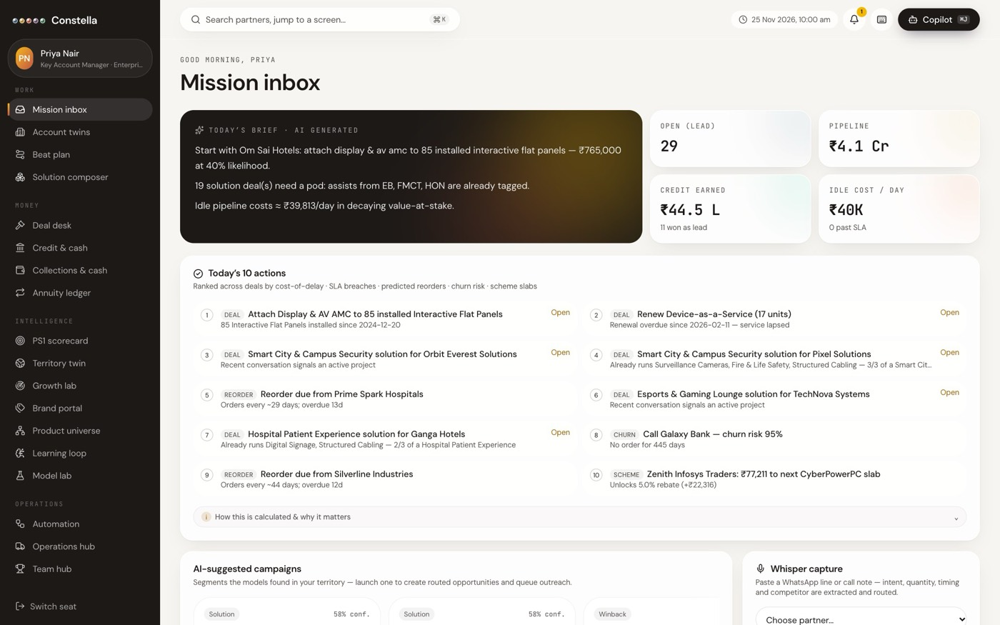<br><b>Mission inbox</b> (rep). The 9:00 AI brief and today's ten actions, ranked by what delay would cost: deals, SLA breaches, predicted reorders, churn risk and scheme slabs. One-tap accept.</td>
<td width="50%">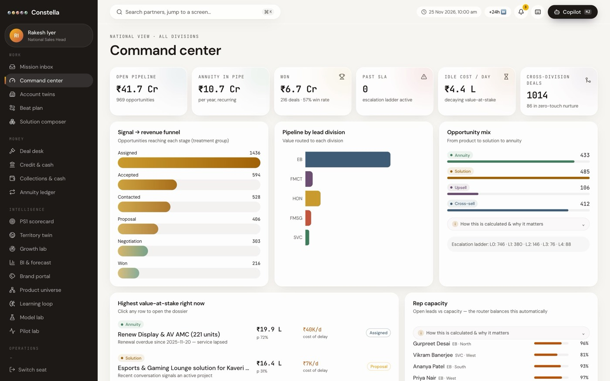<br><b>Command center</b> (sales head). ₹41.7 Cr open pipeline, the signal-to-revenue funnel (1,436 assigned → 216 won), pipeline by division, escalation ladder and rep capacity.</td>
</tr>
<tr>
<td>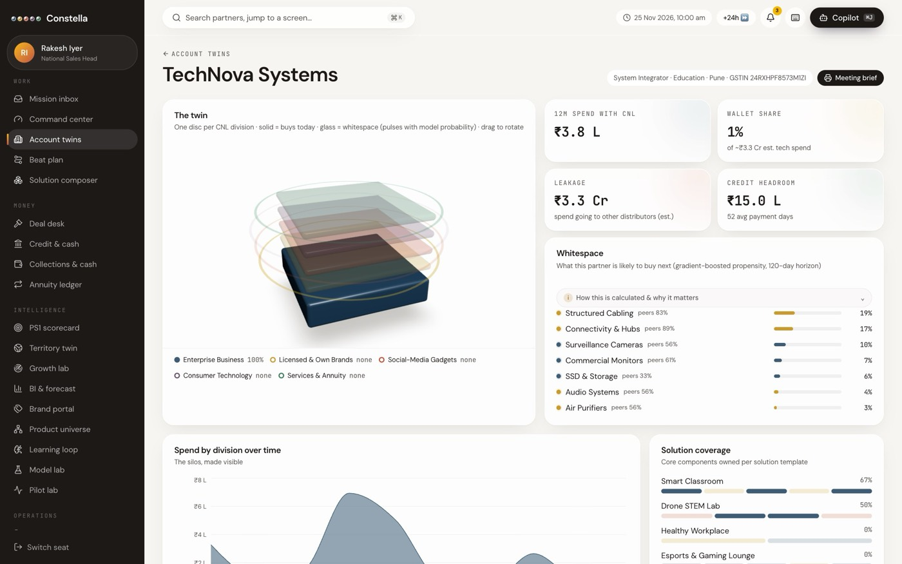<br><b>Account twin</b>. One partner across all five divisions as a 3D stack: wallet share, leakage to other distributors, credit headroom, calibrated whitespace with peer adoption, and solution coverage.</td>
<td>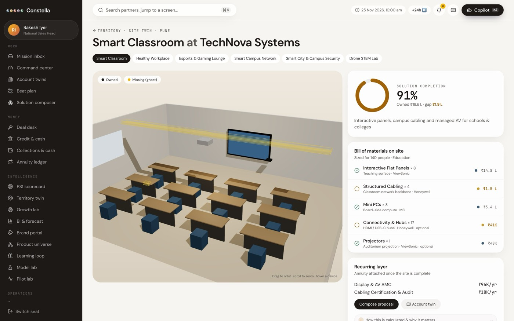<br><b>Site twin</b>. The partner's Smart Classroom in 3D: owned devices solid, missing ones glowing. Bill of materials, value-at-stake, the annuity layer and a signed proposal link.</td>
</tr>
<tr>
<td>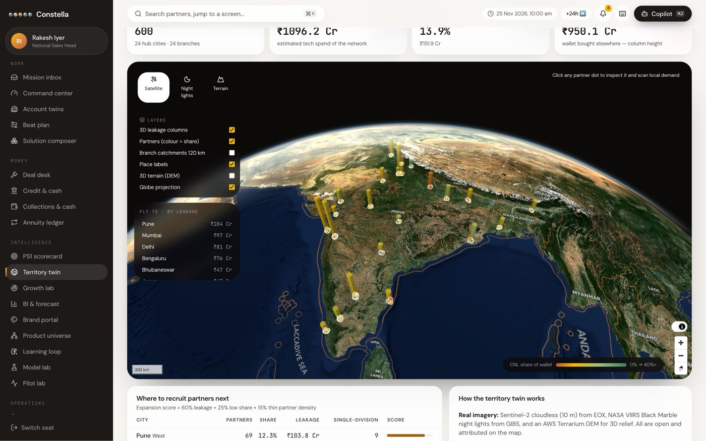<br><b>Territory twin</b>. Sentinel-2 and NASA night-lights globe with 3D leakage columns per city, partner layer, branch catchments and an OpenStreetMap scan of schools and hospitals near each partner.</td>
<td>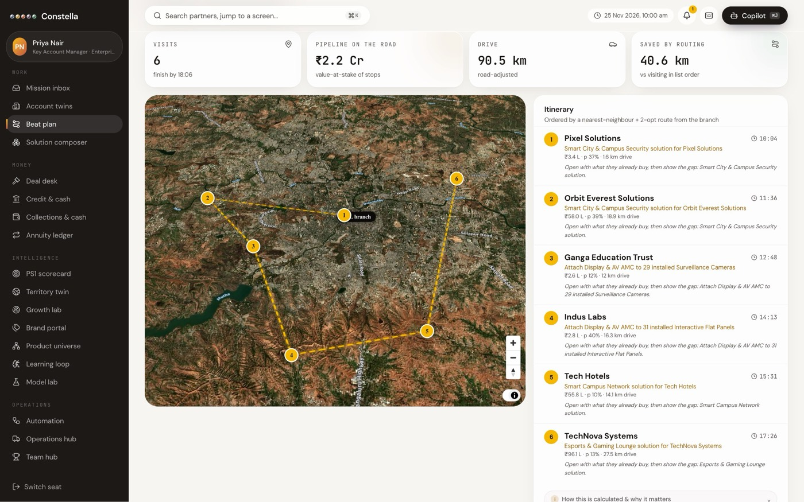<br><b>Beat plan</b>. The field day on a satellite map: highest-value stops first, nearest-neighbour + 2-opt route, with the reason and value of each visit.</td>
</tr>
<tr>
<td>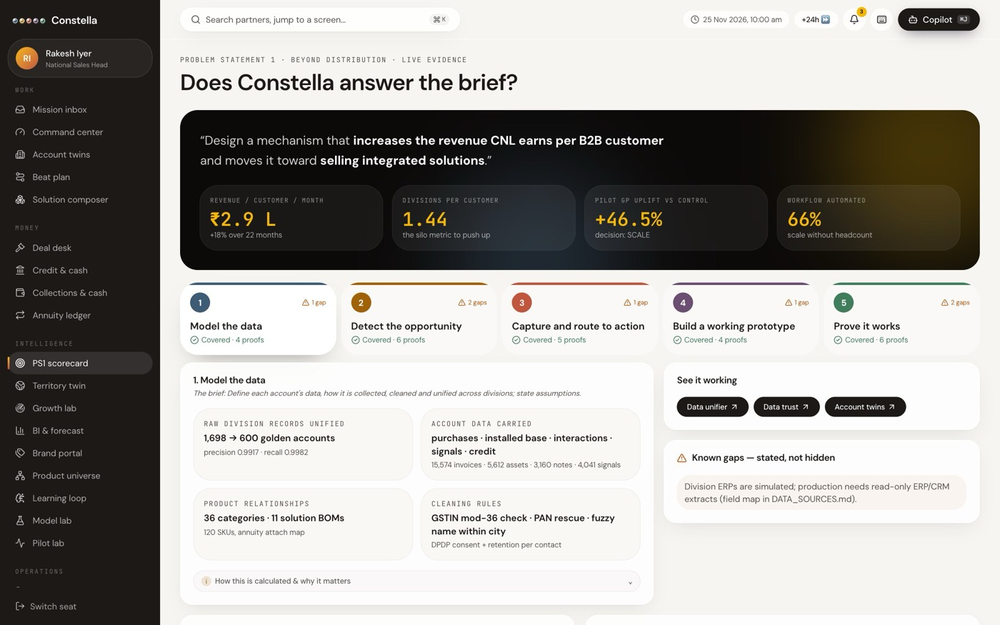<br><b>PS1 scorecard</b>. The five points of the brief, each with live numbers from the system and its known gaps stated honestly.</td>
<td>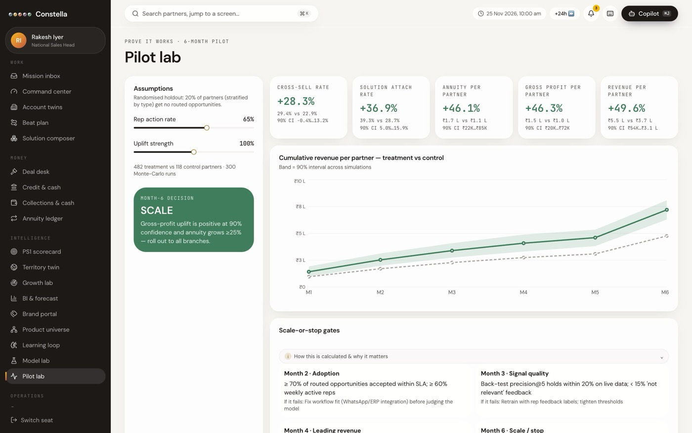<br><b>Pilot lab</b>. Treatment against a randomised control group over six months, with confidence bands and the written scale / extend / stop rule.</td>
</tr>
<tr>
<td>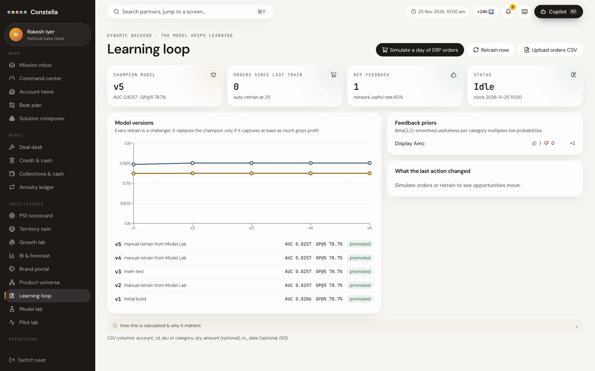<br><b>Learning loop</b>. ERP order ingest, rep feedback priors, live re-scoring and champion/challenger model versions.</td>
<td>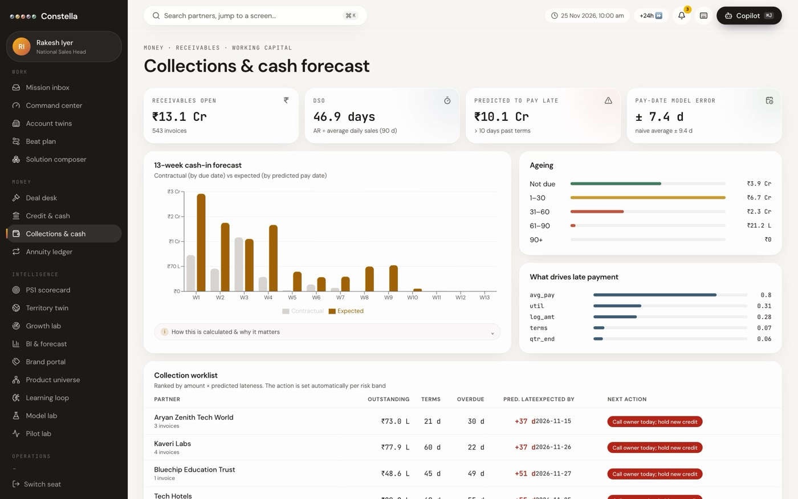<br><b>Collections & cash</b>. Pay-date model, DSO, a 13-week cash forecast and a ranked call worklist.</td>
</tr>
<tr>
<td>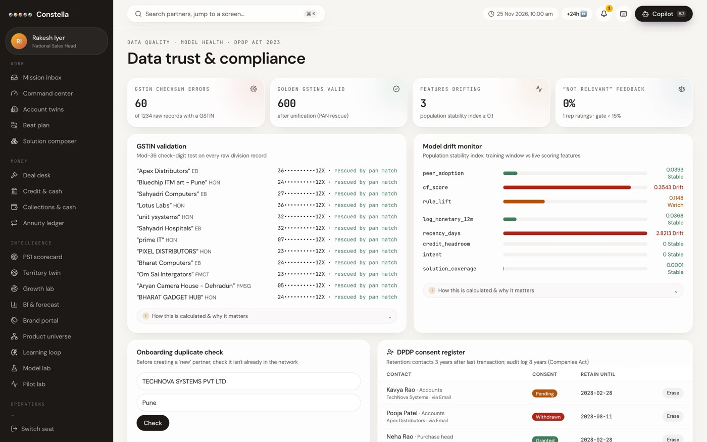<br><b>Data trust</b> (data steward). GSTIN validation, data-quality scores, PSI drift, duplicates and DPDP consent / erasure.</td>
<td>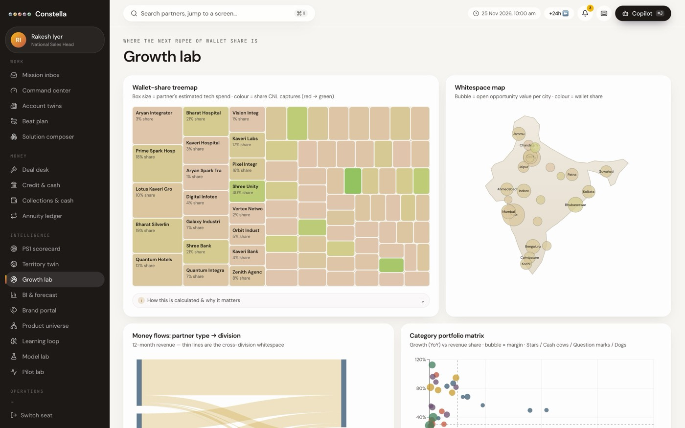<br><b>Growth lab</b>. Treemap, Sankey, RFM, Pareto, cohorts, affinity and next-category paths across the network.</td>
</tr>
<tr>
<td>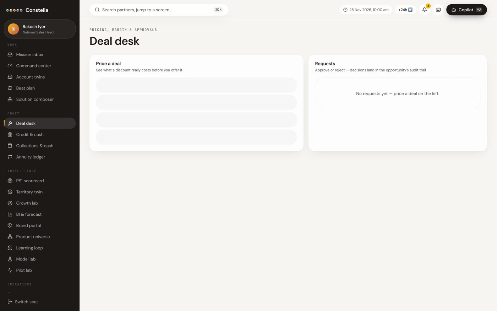<br><b>Deal desk</b>. Approval matrix and pocket-margin waterfall, so no discount goes out below the margin floor.</td>
<td valign="top"><b>And more:</b> solution composer, credit & cash, annuity ledger, BI & forecast, brand portal, product universe, model lab, automation playbooks, operations hub, team hub, data unifier, security & audit, and the partner's proposal page. <b>26 screens</b> in all; try them on the <a href="https://constella-cnl.vercel.app">live prototype</a>.</td>
</tr>
</table>

## 5. Personas: who uses it

The live app opens with **six one-click seats, no password**. Each seat signs in with its own role, territory and data permissions, enforced on every API endpoint, not just in the menu.

| Seat | Role | Goal | Pain today | What Constella gives them |
|---|---|---|---|---|
| **Priya** | Key Account Manager, Enterprise Business, Mumbai (rep, 18 screens) | Grow GP on 40 SI and enterprise accounts | Cannot see what her accounts buy from other divisions | Mission inbox, account twins, whisper capture, deal desk, 5-language pitch |
| **Arjun** | Channel Sales Executive, FMSG, Pune (rep, 18 screens) | Push experiential brands to 180 retailers | Too many accounts, no idea who is ready for what | Value-first beat plan, territory twin, 30% assist credit, scheme-slab alerts |
| **Rakesh** | National Sales Head, Mumbai (head, 24 screens) | More GP per account and more solution mix, without hiring | Finds stalled deals too late | Command center, SLA ladder, pilot lab, BI & forecast, security & audit |
| **Meera** | Solutions Architect, SI desk, Bengaluru (architect, 16 screens) | Turn product baskets into solution proposals | Builds bills of materials by hand across four divisions | Solution composer, 3D site twin, BOM with annuity, signed proposal link |
| **Neha** | Data and RevOps Steward, Mumbai (steward, 15 screens) | One clean record per partner | The same partner exists 3–5 times across ERPs | Data unifier, steward queue, data trust, model lab, DPDP tools |
| **Vikram** | Owner, TechNova Systems, Pune (partner) | Win more school and campus projects | Calls four CNL people for four categories | One proposal link for the whole solution, upfront or monthly payment |

## 6. One opportunity, end to end

The same story can be clicked through on the live app:

1. **09:00, Priya gets the signal.** Her WhatsApp brief and mission inbox list ten actions ordered by cost of delay. TechNova Systems is flagged because a recent conversation points to an active project.
2. **Priya opens the account twin.** TechNova buys ₹3.8 L a year from CNL, about 1% of a ~₹3.3 Cr tech budget. The model shows what it is likely to buy next (structured cabling 19%, connectivity 17%, with peer adoption), and its Smart Classroom is 67% owned.
3. **Meera completes the solution.** The 3D site twin shows the classroom with the missing devices glowing. One of 11 blueprints turns the gap into a bill of materials with value-at-stake and a three-year AMC; the deal desk checks margin floors.
4. **Vikram receives one proposal.** A signed, expiring link shows the whole classroom from one CNL contact instead of four.
5. **Rakesh sees it routed.** Priya (Enterprise Business) leads, Arjun (FMSG) assists, with 70/30 split credit. If nobody moves, the SLA ladder nudges at 48 hours, then reassigns, then alerts the division head, then moves to digital nurture.
6. **Priya and Arjun go to the field.** The beat plan orders visits by value and optimises the route; the voice copilot answers "what next for TechNova?"; the collections worklist says whom to call first.
7. **Rakesh and Neha prove it.** Against a randomised control group, revenue per partner reaches ₹719K vs ₹471K by month six (+53%). New orders and rep ratings re-score the model live, and a rule written before the pilot decides: scale, extend or stop.

## 7. Feature map

| Area | Features |
|---|---|
| **Work** | Mission inbox with AI brief · today's 10 actions · beat planner (route-optimised field day on satellite) · whisper capture (WhatsApp line → routed opportunity) · account twins (3D) · solution composer (BOM, GP, annuity, credit fit) · partner proposal links |
| **Money** | Deal desk (approval matrix, pocket-margin waterfall) · credit grades A–E · NWC simulator · **collections & 13-week cash forecast** (pay-date model, DSO) · annuity ledger and renewal calendar · scheme-slab tracker |
| **Intelligence** | **PS1 scorecard** · **territory twin** (Sentinel-2 / NASA night-lights globe, 3D leakage columns, OSM demand scan) · **site twin** (3D room, owned vs missing devices) · growth lab (treemap, Sankey, RFM, Pareto, cohorts, affinity, next-category paths) · BI & forecast · brand portal · product universe · model lab · **learning loop** · pilot lab |
| **Operations** | Automation playbooks (8 rules, scheduler, outbox) · operations hub (stock-aware selling, GeM tenders, SI projects, RMA, MDF) · team hub (leaderboard, commission simulator, stage velocity) · data trust (GSTIN, PSI drift, dedupe, DPDP consent/erasure) · security & audit |
| **AI assistant** | Role-aware LangGraph copilot (Claude with tools, or an offline planner) · hybrid RAG over playbooks · speech in / speech out · 5-language pitch drafts (en/hi/mr/gu/ta) |

## 8. Architecture

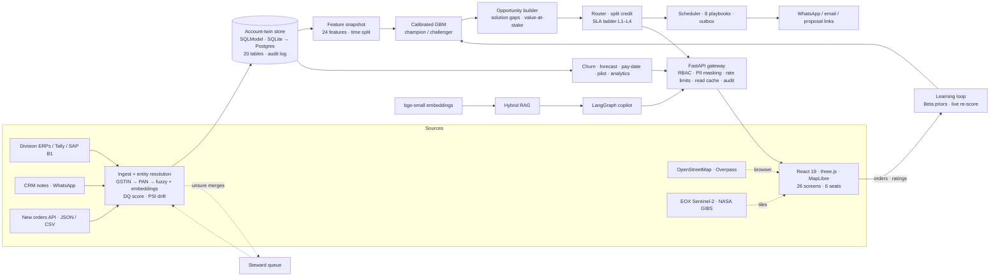

**Backend:** Python 3.12, FastAPI, Pydantic, SQLModel (SQLite; Postgres-ready), pandas, NumPy, scikit-learn, LangGraph, Anthropic SDK (optional), fastembed (ONNX), asyncio scheduler, WebSocket live feed.
**Frontend:** React 19, Vite, TypeScript, Tailwind v4, shadcn/ui, React Bits, React Three Fiber / drei, MapLibre GL, GSAP + Lenis, TanStack Query, Recharts.
**Cloud:** Vercel (web) · Render free plan (API, lite mode) · GitHub Actions keep-alive.

## 9. Models and intelligence

| Model | Type | Purpose | Validation |
|---|---|---|---|
| Next-best-category propensity | HistGradientBoosting + isotonic calibration (trained here) | Detect cross-sell / solution / annuity opportunities | 120-day time-split back-test vs popularity, item-CF and association rules: AUC 0.83, ECE 0.015, precision@5 0.177 vs 0.182 for popularity, GP capture@5 78.7% vs 51.4% |
| Value-at-stake | Analytical | Rank by P × margin × cash velocity × credit fit + 3-yr annuity | Matches CNL's margin × working-capital "quadrant" lens |
| Churn risk | Logistic regression | Revenue at risk | Time-split AUC |
| Demand forecast | Log-linear trend + 2-harmonic Fourier (ridge) | FY29 path, seasonality | Back-test MAPE ≈ 0.23 |
| Pay-date model | HistGradientBoosting regressor | Collections priority, 13-week cash | MAE ≈ 7 days vs 9 days naive |
| **bge-small-en-v1.5** | Pretrained embeddings (BAAI, MIT, ONNX) | Hybrid RAG, intent in rep notes, partner dedupe | Calibrated thresholds; TF-IDF fallback |
| Claude (optional) | LLM via LangGraph tools | Copilot reasoning, pitch drafting | Guard node; offline planner without a key |

Popularity and value ranking hit the **same rate** (an honest tie on precision@5), but value ranking captures **1.5× the gross profit**, because it weighs margin, cash cycle and credit instead of volume alone. Every score ships with reason codes a rep can read.

**Continuous learning.** ERP orders (JSON/CSV) are attributed to open opportunities and trigger an online re-score. Rep 👍/👎 ratings update Beta(2,2)-smoothed priors per category and kind. A **champion/challenger retrain** (nightly, after 25 new orders, or manual) promotes a model only if GP capture@5 does not fall; in a live test, one retrain moved AUC from 0.811 to 0.824 and was promoted. Every run is versioned.

## 10. Impact, measured

From the running prototype and its randomised control-group simulation:

| Metric | Result |
|---|---|
| Revenue per partner, month 6 | **₹719K vs ₹471K** without Constella (+53%) |
| Uplift per treated partner, 6 months | cross-sell +28% · solution attach +37% · annuity ARR +46% · GP +46% · revenue +50% |
| Gross profit captured by ranking | **78.7%** (value) vs 51.4% (popularity) |
| Workflow automated | about **66%** of events, so growth needs no matching headcount |
| Opportunity funnel | 21,600 pairs scored → 4,040 signals → 1,794 opportunities → 10 a day for each rep |
| Economics | break-even below a **0.5%** wallet-share gain; at 1%: about ₹17.7 Cr revenue and ₹1.42 Cr GP a year against a ~₹0.4 Cr pilot; payback in 3–4 months |

## 11. Data, sources and licences

- **CNL partner data is synthetic** (600 partners, 24 months, seeded and reproducible): causal intent events, seasonality, credit behaviour, keying errors in raw records, and AMC contracts sized to installed units. Company facts are calibrated from CNL's investor presentations and the Q2 FY27 earnings call (`docs/RESEARCH.md`).
- **Open data used live:** EOX Sentinel-2 cloudless (CC BY-NC-SA, attribution shown), NASA GIBS Blue Marble / VIIRS Black Marble (NASA open data), AWS Terrarium DEM, and OpenStreetMap via Overpass (ODbL). The full table, with commercial-use notes, is in [`docs/DATA_SOURCES.md`](docs/DATA_SOURCES.md).
- **Media:** landing and video footage are six Pexels-licensed clips, and the pitch-video narration uses the Apache-2.0 Kokoro voice model; both are credited in `docs/DATA_SOURCES.md`.

## 12. Security and compliance

Signed expiring tokens · RBAC on every endpoint (agent tools included) · territory scoping · GSTIN/PAN/PII masking by role · login and API rate limiting · security headers · append-only audit log · **DPDP Act 2023** consent register, retention and erasure (GST books retained) · GSTIN mod-36 validation · signed 14-day partner proposal links · no personal data in map or tile requests.

The read cache described below keys every entry on the **verified** caller (role, rep, region, account), checks the token signature before any lookup, and clears on every write, so it never shares one role's data with another.

## 13. Deployment and performance

```
Browser ──► Vercel (React static build)
              ├─ /api/*  ──rewrite──►  Render web service (FastAPI, lite mode)
              └─ wss://constella-cnl.onrender.com/api/ws/live   (live feed, direct)
```

The API runs on **Render's free plan (512 MB RAM, 0.1 CPU)**, which needs care:

| Technique | Effect |
|---|---|
| **Lite mode** (`CONSTELLA_LITE=true`) | skips the optional embedding model, lazy-loads the copilot libraries, one worker, `MALLOC_ARENA_MAX=2` |
| **Build-time bake** | `python -m app.pipeline` builds the database and model, then computes the live scores and replays every seat's screens into a read cache (452 responses). The free instance only loads them |
| **Read cache** | GET answers are cached per verified caller and cleared by any write. Heavy pages that took 2–5 s on 0.1 CPU answer in about 1 ms (`X-Cache: hit`) |
| **Async health check** | never waits behind heavy work, so Render's 5-second check always passes |
| **Lean front end** | three.js and MapLibre load only on the pages that use them; app pages load about 320 KB less code |
| **Cold-start cover** | a GitHub Actions keep-alive pings during Indian daytime; the app wakes the API on open, shows a friendly notice, and the landing page renders from a baked snapshot meanwhile |

Measured locally in lite mode: start-up in about 3 s, about 276 MB of memory. Setup steps are in [`docs/DEPLOY.md`](docs/DEPLOY.md).

## 14. Getting started

**Prerequisites:** Python 3.12 with [`uv`](https://docs.astral.sh/uv/), Node 20+ with `pnpm`.

```bash
cd backend && uv sync && uv run uvicorn app.main:app --port 8000 --reload
```

```bash
cd frontend && pnpm install && pnpm dev
```

Open **http://localhost:5173** and choose a seat. API docs are at **http://localhost:8000/docs**.

- The first start generates the synthetic network and trains the models (about 15 s). Rebuild with `uv run python -m app.pipeline`.
- The pretrained embedding model (~64 MB) downloads into `backend/data/models/` on first use. Without it, TF-IDF is used.
- Set `ANTHROPIC_API_KEY` to let the copilot use Claude. Without it, a deterministic offline planner answers from the same tools.
- To try the small-host setup: `cd backend && CONSTELLA_LITE=true uv run python -m app.pipeline && CONSTELLA_LITE=true uv run uvicorn app.main:app --port 8000`.

## 15. Demo walkthrough (7 minutes)

1. **Landing** → the brief, the five-point answer, live proof → *Take a seat* as **Rakesh (National Sales Head)**.
2. **PS1 scorecard** → each objective with live numbers and stated gaps.
3. **Territory twin** → satellite globe → fly to Pune → click a partner → *Scan schools & hospitals* → addressable ₹.
4. **Site twin** → Smart Classroom at TechNova: owned devices vs glowing gaps, gap value, annuity layer.
5. Switch seat to **Priya (KAM)** → **Mission inbox** → accept → share the proposal link → **Beat plan**.
6. **Learning loop** → *Simulate a day of ERP orders* → opportunities re-score → retrain → v2 promoted or rejected.
7. **Collections & cash** → DSO, 13-week forecast, worklist. **Pilot lab** → the scale / stop decision.

## 16. Verification

| Check | Result |
|---|---|
| 46 GET endpoints × 5 roles | All 200; refusals are role-based 403s by design |
| 18 end-to-end write flows (accept → feedback → proposal → capture → orders → retrain → clock → RBAC) | Pass |
| `pnpm build` | Clean |
| 26 app screens (browser sweep, local and production) | Render with no console errors and no horizontal overflow |
| Read cache | cached answer byte-identical to a fresh one; any write clears it; roles never share entries; a forged token gets 401 |

## 17. Repository layout

```
backend/app/
  api/          REST routers (platform, opportunities, accounts, automation, agent, insights, finance, labs, geo)
  agent/        LangGraph copilot, tools, RAG, knowledge base (kb/*.md)
  core/         config, db, security (tokens, RBAC, masking, rate limits), read cache
  data/         catalogue, synthetic world, entity resolution
  ml/           features, model, opportunity builder, embeddings, semantic intents
  routing/      router, SLA, cost of delay
  services/     ops, automation, scheduler, pilot, insights, finance, analytics, geo, learning, scorecard, fieldmoney
  bake.py       build-time bake for small hosts (scores + every seat's screens)
backend/scripts/ record_bake_routes.py (which API calls each seat makes)
frontend/src/
  pages/        Landing, partner proposal
  app/          shell, copilot, kit, 26 screens
  components/   three.js (globe, constellation, twins), landing sections, React Bits
tools/deck/     generator for the pitch deck (pptxgenjs); team details stay in a git-ignored local file
docs/           research, problems, features, data sources, uniqueness, deploy, progress, images
```

## 18. Limitations and roadmap

- Partner data is synthetic. The pilot projection is a simulation until it runs on CNL's ERP extracts.
- The public Overpass endpoint is often at capacity, so the demand scan falls back to labelled synthetic points. Production would run a private Overpass/PostGIS instance.
- EOX Sentinel-2 cloudless is free for non-commercial use only. Production needs the EOX commercial licence or a licensed imagery layer, switchable in config.
- On Render's free plan the API sleeps after 15 idle minutes; outside the keep-alive window the first visit takes 30–60 s. A paid instance or an external pinger removes this.
- Next: WhatsApp Business API integration, an ERP connector for SAP B1 / Tally, Postgres + pgvector, a pytest suite in CI, and a partner-side mobile view.

## 19. Deliverables and documentation

| Deliverable | Where |
|---|---|
| Live prototype | https://constella-cnl.vercel.app |
| Live API documentation | https://constella-cnl.onrender.com/docs |
| Solution document (38 pages, Word + PDF) and pitch video | [Google Drive folder](https://drive.google.com/drive/folders/1TuzWLrr9LLNL6KPNZAltIrK8jScpjtsk?usp=sharing) |

| Document | Contents |
|---|---|
| [`docs/RESEARCH.md`](docs/RESEARCH.md) | Company research, personas, industry practice, Q2 FY27 disclosures |
| [`docs/PROBLEMS.md`](docs/PROBLEMS.md) | 155 stakeholder problems in 13 categories, each with a platform answer |
| [`docs/FEATURES.md`](docs/FEATURES.md) | Feature catalogue, with the reasoning and calculation behind each feature |
| [`docs/DATA_SOURCES.md`](docs/DATA_SOURCES.md) | Free and licensed data, imagery, models, footage, attribution |
| [`docs/UNIQUENESS.md`](docs/UNIQUENESS.md) | Honest comparison with Ingram Xvantage, Redington, Salesforce NBA |
| [`docs/DEPLOY.md`](docs/DEPLOY.md) | Render + Vercel setup, lite mode, bake, read cache, keep-alive |
| [`docs/PROGRESS.md`](docs/PROGRESS.md) | Build log and test results |
| [`design-system/constella/MASTER.md`](design-system/constella/MASTER.md) | Visual system |

## 20. Team

**Team Outliers**: four builders with **34 hackathon wins** between them.

| Member | Hackathon wins |
|---|---|
| Swayam Panchal | 5× winner |
| Jeevesh Bodhani | 10× winner |
| Rishit Lahoti | 10× winner |
| Shreyas Kale | 9× winner |

<sub>Built for the Creative Newtech × E-Cell IIT Bombay hackathon. Partner data is synthetic; company facts are cited from CNL public filings. Not affiliated with or endorsed by the brands named.</sub>
