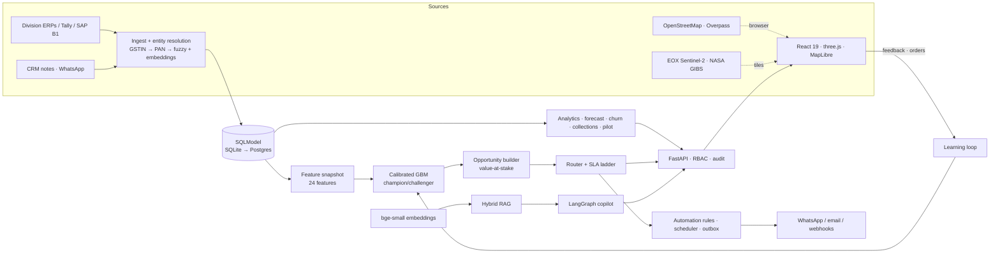

<div align="center">

# Constella

**Account-twin revenue intelligence for Creative Newtech Limited**

*Creative Newtech × E-Cell IIT Bombay Hackathon · Problem Statement 1 — "Beyond Distribution: growing wallet share and solution selling across the customer network"*

`FastAPI` · `scikit-learn` · `LangGraph` · `bge-small embeddings` · `React 19` · `three.js` · `MapLibre` · `Sentinel-2 / NASA GIBS` · `OpenStreetMap`

</div>

---

## Contents

1. [The problem](#1-the-problem)
2. [What Constella does](#2-what-constella-does)
3. [How it answers the five PS points](#3-how-it-answers-the-five-ps-points)
4. [Feature map](#4-feature-map)
5. [Architecture](#5-architecture)
6. [Models and intelligence](#6-models-and-intelligence)
7. [Data, sources and licences](#7-data-sources-and-licences)
8. [Security and compliance](#8-security-and-compliance)
9. [Getting started](#9-getting-started)
10. [Demo walkthrough](#10-demo-walkthrough-7-minutes)
11. [Verification](#11-verification)
12. [Repository layout](#12-repository-layout)
13. [Limitations and roadmap](#13-limitations-and-roadmap)
14. [Documentation index](#14-documentation-index)

---

## 1. The problem

Creative Newtech (CNL) distributes **25+ brands and 5,000+ products** to **10,000+ B2B partners** (resellers, system integrators, retailers, enterprises) through **five divisions** and **31+ branches** (FY25 revenue ₹1,774 Cr, EBITDA ≈ 4%). The problem statement names three structural issues:

| # | Issue in the brief | Consequence |
|---|---|---|
| 1 | What a customer buys is **spread across divisions and sales teams**; each team sees only its own slice | Wallet share is invisible; cross-division whitespace leaks to other distributors |
| 2 | **No systematic way** to spot when several products together form a **solution** or upsell | CNL sells boxes and misses higher-margin solutions and recurring (annuity) revenue |
| 3 | CNL **cannot grow sales headcount** in proportion to portfolio growth | Prioritisation and automation decide whether more brands become more revenue |

**Goal:** raise revenue per B2B customer and move CNL toward integrated solutions and annuity revenue that keeps partners loyal.

## 2. What Constella does

Constella builds a **digital twin of every partner**. Five division ledgers are unified into one golden record. A calibrated model finds the **next product, the missing pieces of a solution, or a service plan**, ranked by what it is worth to *CNL* (margin × cash velocity × credit fit). It **routes** each opportunity to one accountable owner, with assists and split credit across divisions. It **automates** the follow-up (WhatsApp brief, SLA ladder, renewals) and **proves** the uplift against a randomised control group. It keeps **learning** from every new order and every rep rating.

```
Signal in the data ─► Scored opportunity ─► Routed owner (+ assists) ─► WhatsApp brief / inbox
       ▲                                                                       │
       │                                                                       ▼
 Retrain (champion/challenger) ◄── Feedback + order attribution ◄── Proposal link ─► PO ─► Annuity
```

## 3. How it answers the five PS points

| PS point | Constella's answer | Live evidence (from the running system) | Where |
|---|---|---|---|
| **1 · Model the data** | Account twin: purchases, installed base, product relationships, credit, interactions, signals. Raw records from each division's ERP are unified by **GSTIN → PAN → fuzzy name within city**, with GSTIN check-digit validation | 1,698 raw records → 600 golden partners · precision 0.99 · recall 0.998 | `data/unify.py`, **Data unifier**, **Data trust** |
| **2 · Detect the opportunity** | Calibrated gradient-boosted propensity over 24 explainable features. Solution-gap detection against 11 solution blueprints. Ladder: cross-sell → upsell → solution → annuity. Ranked by value-at-stake | Time-split back-test AUC ≈ 0.82; captures ≈ 1.7× the gross profit of popularity ranking; ECE ≈ 0.02 | `ml/*`, **Model lab**, **Learning loop** |
| **3 · Capture & route** | One lead owner and cross-division assists with **70/30 split credit**; overlap merge; capacity-aware routing; SLA ladder **L1 nudge → L2 reassign → L3 head → L4 digital nurture**; full audit trail to closed revenue | All routed opportunities assigned (median ≈ 3 min); ≈ 89% accepted within the 48 h SLA | `routing/engine.py`, `services/ops.py`, **Mission inbox** |
| **4 · Working prototype** | Six role workspaces: rep, KAM, sales head, architect, data steward, partner. WhatsApp-first brief, one-tap accept, voice copilot, beat planner, ERP order ingest | ≈ 65% of workflow events automated; 26 screens | `frontend/src/app/**` |
| **5 · Prove it works** | 20% stratified hold-out; Monte-Carlo pilot vs a control-calibrated counterfactual; order-matching attribution; **scale / extend / stop** gates at months 2, 3, 4, 6 | GP / partner uplift with a 90% interval; ARR uplift; verdict shown live | `services/pilot.py`, **Pilot lab**, **PS1 scorecard** |

The **PS1 scorecard** screen (`/app/scorecard`) recomputes this table live and lists the known gaps next to each point.

## 4. Feature map

| Area | Features |
|---|---|
| **Work** | Mission inbox with AI brief · today's 10 actions · beat planner (route-optimised field day on satellite) · whisper capture (WhatsApp line → routed opportunity) · account twins (3D) · solution composer (BOM, GP, annuity, credit fit) · partner proposal links |
| **Money** | Deal desk (approval matrix, pocket-margin waterfall) · credit grades A–E · NWC simulator · **collections & 13-week cash forecast** (pay-date model, DSO) · annuity ledger and renewal calendar · scheme-slab tracker |
| **Intelligence** | **PS1 scorecard** · **territory twin** (Sentinel-2 / NASA night-lights globe, 3D leakage columns, OSM demand scan) · **site twin** (3D room, owned vs missing devices) · growth lab (treemap, Sankey, RFM, Pareto, cohorts, affinity, next-category paths) · BI & forecast · brand portal · product universe · model lab · **learning loop** · pilot lab |
| **Operations** | Automation playbooks (8 rules, scheduler, outbox) · operations hub (stock-aware selling, GeM tenders, SI projects, RMA, MDF) · team hub (leaderboard, commission simulator, stage velocity) · data trust (GSTIN, PSI drift, dedupe, DPDP consent/erasure) · security & audit |
| **AI assistant** | Role-aware LangGraph copilot (Claude with tools, or an offline planner) · hybrid RAG over playbooks · speech in / speech out · 5-language pitch drafts (en/hi/mr/gu/ta) |

## 5. Architecture



**Backend:** FastAPI, SQLModel (SQLite; Postgres-ready), pandas, scikit-learn, LangGraph, Anthropic SDK, fastembed (ONNX), asyncio scheduler, WebSocket live feed.
**Frontend:** React 19, Vite, TypeScript, Tailwind v4, shadcn/ui, React Bits, React Three Fiber / drei / postprocessing, MapLibre GL, GSAP + Lenis, TanStack Query, Recharts.

## 6. Models and intelligence

| Model | Type | Purpose | Validation |
|---|---|---|---|
| Next-best-category propensity | HistGradientBoosting + isotonic calibration (trained here) | Detect cross-sell / solution / annuity opportunities | 120-day time-split back-test vs popularity, item-CF and association rules; AUC, precision@5, GP capture@5, ECE, Brier |
| Value-at-stake | Analytical | Rank by P × margin × cash velocity × credit fit + 3-yr annuity | Matches CNL's margin × working-capital "quadrant" lens |
| Churn risk | Logistic regression | Revenue at risk | Time-split AUC |
| Demand forecast | Log-linear trend + 2-harmonic Fourier (ridge) | FY29 path, seasonality | Back-test MAPE ≈ 0.23 |
| Pay-date model | HistGradientBoosting regressor | Collections priority, 13-week cash | MAE ≈ 7 days vs 9 days naive |
| **bge-small-en-v1.5** | Pretrained embeddings (BAAI, MIT, ONNX) | Hybrid RAG, intent in rep notes, partner dedupe | Calibrated thresholds; TF-IDF fallback |
| Claude (optional) | LLM via LangGraph tools | Copilot reasoning, pitch drafting | Guard node; offline planner without a key |

**Continuous learning.** ERP orders (JSON/CSV) → attribution → online re-score of open opportunities. Rep 👍/👎 → Beta-smoothed priors per category and kind. A **champion/challenger retrain** (nightly, after 25 new orders, or manual) promotes a model only if GP capture@5 does not fall. Every run is versioned.

## 7. Data, sources and licences

- **CNL partner data is synthetic** (600 partners, 24 months, seeded and reproducible): causal intent events, seasonality, credit behaviour, keying errors in raw records, AMC contracts sized to installed units. Company facts are calibrated from CNL's investor presentations and the Q2 FY27 earnings call (`docs/RESEARCH.md`).
- **Open data used live:** EOX Sentinel-2 cloudless (CC BY-NC-SA, attribution shown), NASA GIBS Blue Marble / VIIRS Black Marble (NASA open data), AWS Terrarium DEM, OpenStreetMap via Overpass (ODbL). Full table with commercial-use notes: [`docs/DATA_SOURCES.md`](docs/DATA_SOURCES.md).

## 8. Security and compliance

Signed expiring tokens · RBAC on every endpoint (agent tools included) · territory scoping · GSTIN/PAN/PII masking by role · login and API rate limiting · security headers · append-only audit log · **DPDP Act 2023** consent register, retention and erasure (GST books retained) · GSTIN mod-36 validation · signed 14-day partner proposal links · no personal data in map or tile requests.

## 9. Getting started

**Prerequisites:** Python 3.12 with [`uv`](https://docs.astral.sh/uv/), Node 20+ with `pnpm`.

```bash
cd backend && uv sync && uv run uvicorn app.main:app --port 8000 --reload
```

```bash
cd frontend && pnpm install && pnpm dev
```

Open **http://localhost:5173** and choose a seat. API docs are at **http://localhost:8000/docs**.

- The first start generates the synthetic network and trains the models (≈ 15 s). Rebuild with `uv run python -m app.pipeline`.
- The pretrained embedding model (~64 MB) downloads into `backend/data/models/` on first use. Without it, TF-IDF is used.
- Set `ANTHROPIC_API_KEY` to let the copilot use Claude. Without it, a deterministic offline planner answers from the same tools.

## 10. Demo walkthrough (7 minutes)

1. **Landing** → the brief, the five-point answer, live proof → *Take a seat* as **Rakesh (National Sales Head)**.
2. **PS1 scorecard** → each objective with live numbers and stated gaps.
3. **Territory twin** → satellite globe → fly to Pune → click a partner → *Scan schools & hospitals* → addressable ₹.
4. **Site twin** → Smart Classroom at TechNova: owned devices vs gold ghosts, gap value, annuity layer.
5. Switch seat to **Priya (KAM)** → **Mission inbox** → accept → share proposal link → **Beat plan**.
6. **Learning loop** → *Simulate a day of ERP orders* → opportunities re-score → retrain → v2 promoted or rejected.
7. **Collections & cash** → DSO, 13-week forecast, worklist. **Pilot lab** → scale / stop decision.

## 11. Verification

Results of the latest full run:

| Check | Result |
|---|---|
| 46 GET endpoints × 5 roles | All 200; refusals are role-based 403s by design |
| 18 end-to-end write flows (accept → feedback → proposal → capture → orders → retrain → clock → RBAC) | Pass |
| `pnpm build` | Clean |
| 26 app screens (browser sweep) | Render with no console errors and no horizontal overflow |

## 12. Repository layout

```
backend/app/
  api/          REST routers (platform, opportunities, accounts, automation, agent, insights, finance, labs, geo)
  agent/        LangGraph copilot, tools, RAG, knowledge base (kb/*.md)
  core/         config, db, security (tokens, RBAC, masking, rate limits)
  data/         catalogue, synthetic world, entity resolution
  ml/           features, model, opportunity builder, embeddings, semantic intents
  routing/      router, SLA, cost of delay
  services/     ops, automation, scheduler, pilot, insights, finance, analytics, geo, learning, scorecard, fieldmoney
frontend/src/
  pages/        Landing, partner proposal
  app/          shell, copilot, kit, 26 screens
  components/   three.js (globe, constellation, twins), landing sections, React Bits
docs/           research, problems, features, data sources, uniqueness, progress
```

## 13. Limitations and roadmap

- Partner data is synthetic. The pilot projection is a simulation until it runs on CNL's ERP extracts.
- The public Overpass endpoint is often at capacity, so the demand scan falls back to labelled synthetic points. Production would run a private Overpass/PostGIS instance.
- EOX Sentinel-2 cloudless is free for non-commercial use only. Production needs the EOX commercial licence or a licensed imagery layer, switchable in config.
- Next: WhatsApp Business API integration, an ERP connector for SAP B1 / Tally, Postgres + pgvector, a pytest suite in CI, and a partner-side mobile view.

## 14. Documentation index

| Document | Contents |
|---|---|
| [`docs/RESEARCH.md`](docs/RESEARCH.md) | Company research, personas, industry practice, Q2 FY27 disclosures |
| [`docs/PROBLEMS.md`](docs/PROBLEMS.md) | 155 stakeholder problems in 13 categories, each with a platform answer |
| [`docs/FEATURES.md`](docs/FEATURES.md) | Feature catalogue, with the reasoning and calculation behind each feature |
| [`docs/DATA_SOURCES.md`](docs/DATA_SOURCES.md) | Free and licensed data, imagery, models, attribution |
| [`docs/UNIQUENESS.md`](docs/UNIQUENESS.md) | Honest comparison with Ingram Xvantage, Redington, Salesforce NBA |
| [`docs/PROGRESS.md`](docs/PROGRESS.md) | Build log and test results |
| [`design-system/constella/MASTER.md`](design-system/constella/MASTER.md) | Visual system |

<sub>Built for the Creative Newtech × E-Cell IIT Bombay hackathon. Partner data is synthetic; company facts are cited from CNL public filings. Not affiliated with or endorsed by the brands named.</sub>
